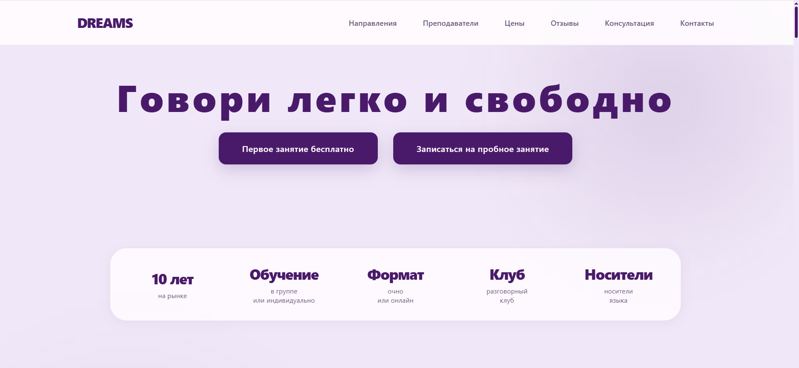
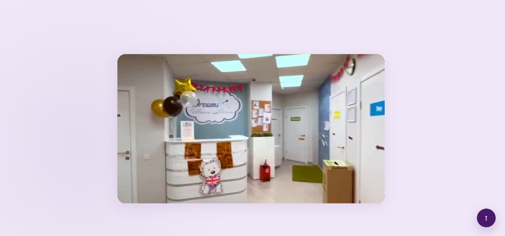
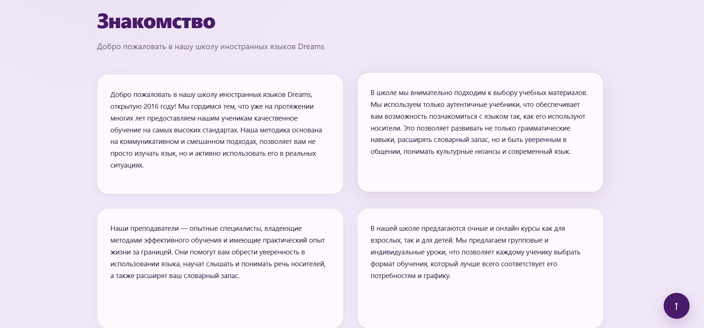
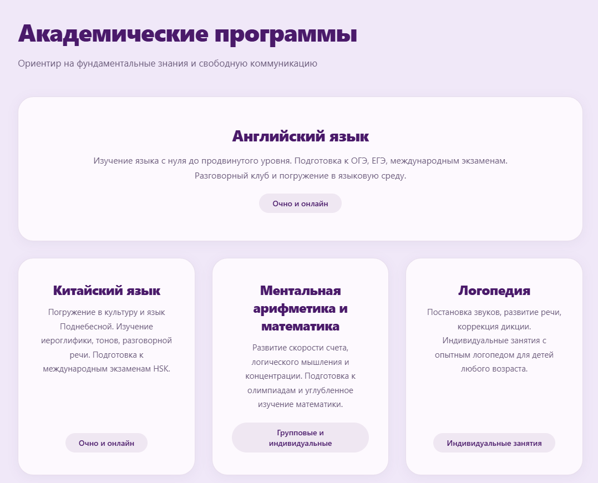
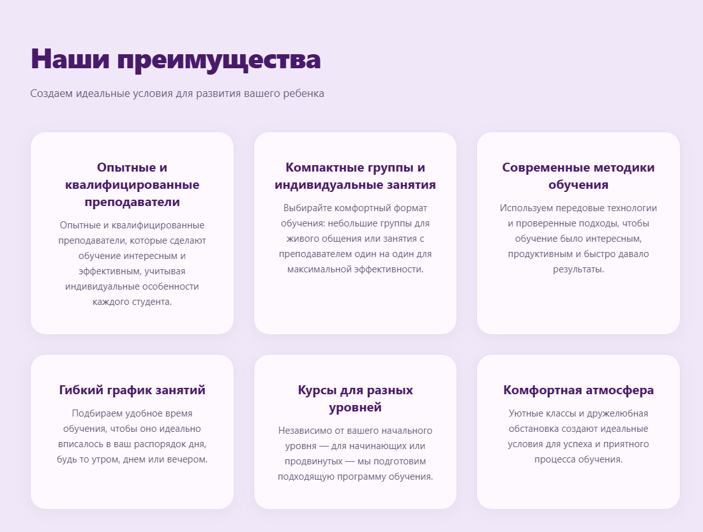
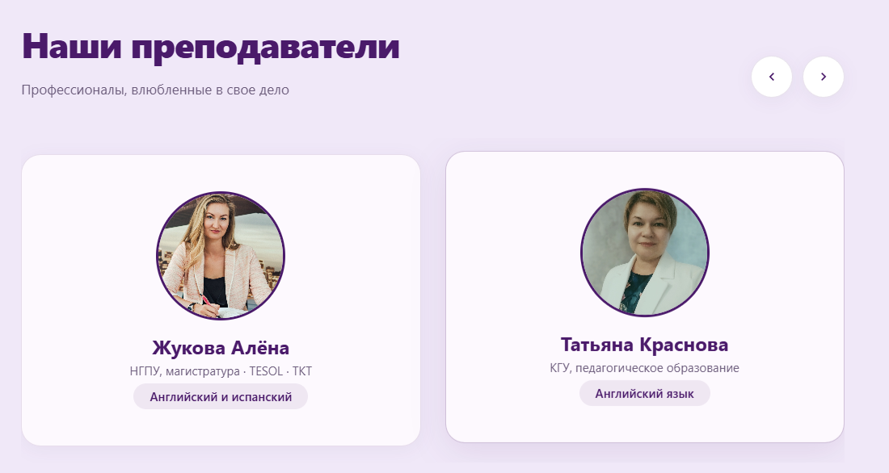
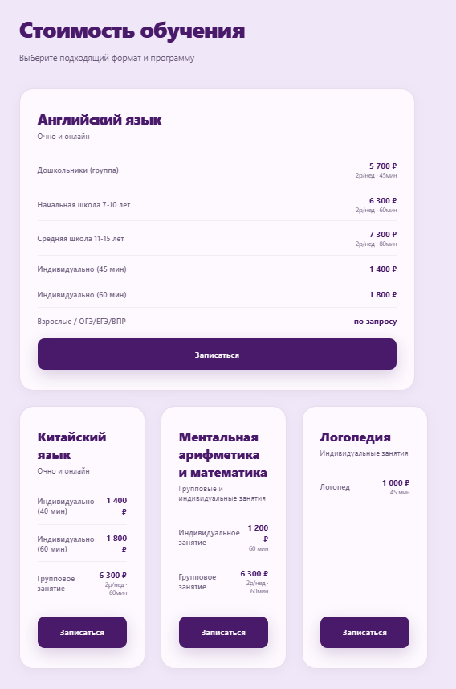
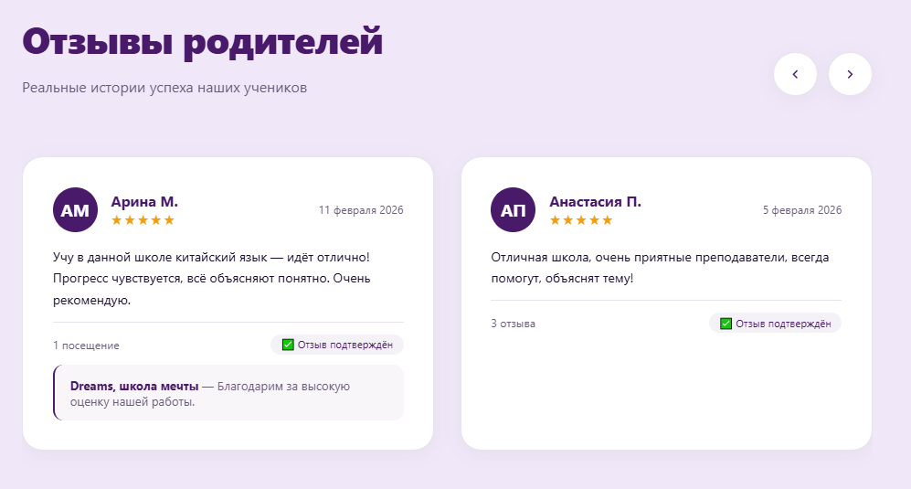
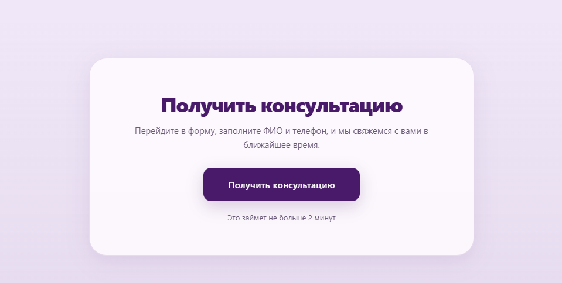
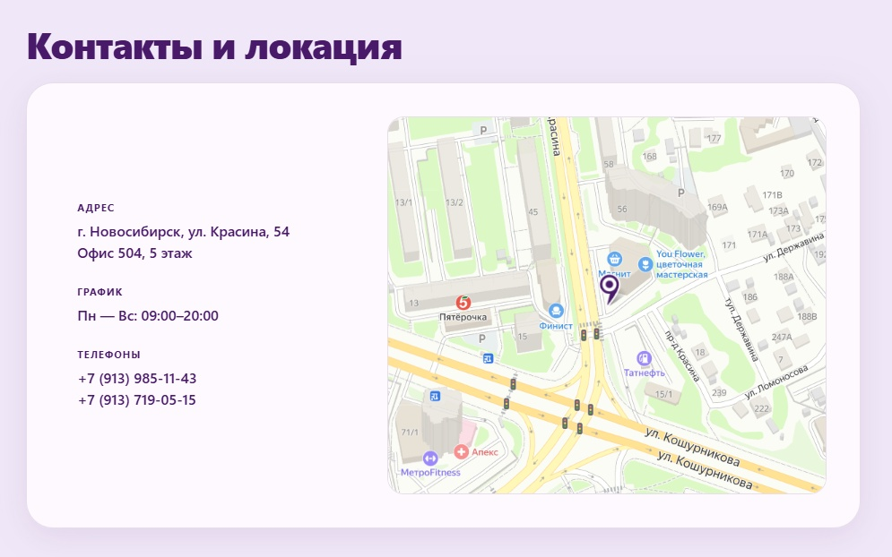

# Dreams — Школа иностранных языков

Официальный веб-сайт школы иностранных языков **Dreams** в г. Новосибирск. Проект включает в себя информацию об академических программах, преподавателях, стоимости обучения, реальных отзывах учеников и интерактивную форму обратной связи.

---

##  Технологии

* **Frontend:** HTML5, CSS3, JavaScript (ES6+)
* **Интеграции:** Яндекс.Карты API

---

##  Обзор страниц и функционала сайта

### 1. Главный экран (Hero Section)

* **Назначение:** Привлечение внимания потенциальных клиентов и демонстрация ключевых преимуществ школы.
* **Функционал:**
  * Шапка сайта с навигацией по разделам (*Направления, Преподаватели, Цены, Отзывы, Консультация, Контакты*).
  * Кнопки быстрой записи на бесплатное или пробное занятие.
  * Инфо-блок с ключевыми достижениями: 10 лет на рынке, форматы обучения (группы и индивидуально, очно/онлайн), разговорный клуб и носители языка.

---

### 2. Интерьер и атмосфера студии

* **Назначение:** Создание доверия у родителей и учеников за счет демонстрации реального пространства школы.
* **Функционал:**
  * Фотозона ресепшена, уютные учебные классы и комфортная обстановка для занятий.

---

### 3. О школе и знакомство

* **Назначение:** Знакомство с историей и философией учебного центра.
* **Функционал:**
  * Информация об открытии школы в 2016 году.
  * Описание методики обучения (коммуникативный и смешанный подход, аутентичные учебники).
  * Информация о квалифицированных преподавателях и гибких форматах занятий для детей и взрослых.

---

### 4. Академические программы

* **Назначение:** Презентация доступных направлений обучения.
* **Функционал:**
  * **Английский язык:** от нуля до продвинутого уровня, подготовка к ОГЭ, ЕГЭ и международным экзаменам.
  * **Китайский язык:** погружение в культуру, иероглифика, тоны, подготовка к HSK.
  * **Ментальная арифметика и математика:** развитие скорости счета и логики.
  * **Логопедия:** постановка звуков и коррекция дикции.

---

### 5. Преимущества школы

* **Назначение:** Демонстрация сильных сторон учебного центра.
* **Функционал:**
  * Опытные педагоги, компактные группы, передовые методики, гибкий график и комфортные классы.

---

### 6. Наши преподаватели

* **Назначение:** Повышение экспертности за счет открытой информации о педагогическом составе.
* **Функционал:**
  * Карточки преподавателей с указанием квалификации, образования и преподаваемых языков.
  * Интерактивный слайдер для просмотра профилей всех специалистов.

---

### 7. Стоимость обучения

* **Назначение:** Прозрачное информирование о ценовой политике.
* **Функционал:**
  * Подробный прайс-лист по каждому направлению (разделение по возрасту детей, длительности занятий и формату: группа / индивидуально).
  * Кнопки **«Записаться»** возле каждого тарифного блока.

---

### 8. Отзывы родителей

* **Назначение:** Социальное доказательство качества обучения.
* **Функционал:**
  * Карточки с реальными отзывами учеников и родителей, рейтингом (5 звезд), датами публикаций и отметками о верификации.
  * Официальные ответы администрации школы на отзывы.

---

### 9. Получить консультацию

* **Назначение:** Сбор лидов и заявок на обратную связь.
* **Функционал:**
  * Быстрый призыв к действию с предложением оставить контакты для связи в течение 2 минут.

---

### 10. Контакты и локация

* **Назначение:** Удобная навигация для физического посещения школы.
* **Функционал:**
  * Адрес: г. Новосибирск, ул. Красина, 54, офис 504 (5 этаж).
  * График работы: Пн—Вс с 09:00 до 20:00.
  * Номера телефонов для прямой связи и интерактивная карта Яндекс с маркером.
